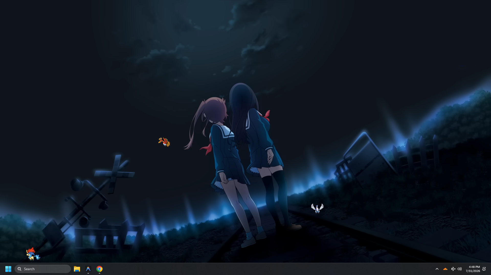

# PokeDesk

PokeDesk places animated Pokémon on the usable area of every desktop display.
Transparent overlay space is click-through, so normal work continues. Hover a
Pokémon to activate its small hitbox, then click to pet it or drag it somewhere
new.



## Features

- Roaming companions constrained to each display's work area, above the
  taskbar or dock.
- Ground Pokémon walk along the desktop edge; flying and hovering Pokémon roam
  freely through the usable area.
- Multi-monitor overlays with no taskbar or Alt+Tab entries.
- Search across 634 bundled Generation 1–5 sprite folders.
- Named spawn, random spawn, individual despawn, and clear-all controls.
- Native, minimizable settings window plus notification-area tray menu.
- Persistent team, positions, pause state, and sprite size.
- Click-through transparent space with interactive Pokémon hitboxes.

## Run

Use Node 20.19 or newer in the Node 20 line.

```powershell
npm ci
npm run dev
```

PokeDesk starts in the notification area with its settings window hidden. Click
the tray icon to open it. Once open, it can minimize to the taskbar; closing it
hides it in the notification area while companions continue roaming.

## Controls

- Click a Pokémon: pet it.
- Drag a ground Pokémon: reposition it left or right along the desktop edge.
- Drag a flying Pokémon: reposition it anywhere on the current display.
- Tray click: open or restore settings.
- Tray menu: random spawn, pause/resume, remove all, or quit.
- Settings search: type a Pokémon name and choose **Spawn**.

New companions appear on the display containing the mouse cursor.

## Verify and package

```powershell
npm run check
npm run pack
npm run dist:win
```

`npm run pack` creates an unpacked app. `npm run dist:win` creates both an NSIS
setup executable and a portable executable under `release/`. Every push to
`main` runs the Windows release workflow and publishes both executables on the
repository's GitHub Releases page. Production executables should be code-signed
before distribution.

## Architecture

Electron main process owns state, tray, and one transparent overlay
`BrowserWindow` per display. Bounds come from Electron's display `workArea`, so
OS-reserved taskbar space stays untouched. A sandboxed preload exposes only
specific IPC methods. Overlay renderers animate at a capped 30 FPS and report
normalized positions periodically.

Movement behavior is bundled with the catalog. Unknown species default to
ground movement, while Flying-type, Levitate, and visibly hovering sprites use
two-dimensional movement. Stored ground companions are moved to the desktop
edge automatically after an update.

The app is Windows-first. Electron's forwarded mouse-move support also enables
the dynamic click-through interaction on macOS; Linux window-manager behavior
varies.

## Credits

PokeDesk was vibe-coded with AI assistance. The
[vscode-pokemon](https://github.com/jakobhoeg/vscode-pokemon) project was the
reference for companion behavior and the source of the bundled sprite and UI
assets. PokeDesk adapts that extension into a standalone Electron desktop app.

See [THIRD_PARTY_NOTICES.md](THIRD_PARTY_NOTICES.md). PokeDesk is an unofficial
fan project and is not affiliated with Nintendo, The Pokémon Company, or Game
Freak.
